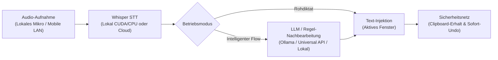

# Velodictum

> **Lokale KI-Spracheingabe und Text-Transformation für Windows**  
> Ein schlanker, quelloffener Desktop-Assistent für systemweites Diktieren mit lokaler oder cloudbasierter Spracherkennung und optionaler semantischer KI-Nachbearbeitung (Ollama / Cloud-APIs).

[](https://microsoft.com/windows)
[](https://python.org)
[](https://github.com/SYSTRAN/faster-whisper)
[](https://riverbankcomputing.com/software/pyqt/)
[](LICENSE)

[English](README.md) | **Deutsch**

> [!NOTE]
> **Projekthintergrund & KI-Hinweis:**  
> Dieses Projekt entstand primär im agentenbasierten Pair Programming mit einem KI-Coding-Agenten (Google Gemini). Es diente ursprünglich als praktisches Experimentierfeld zur Erprobung autonomer Coding-Agenten und moderner Desktop-Workflows. Da sich die resultierende Anwendung im täglichen Arbeitseinsatz als überaus nützlich erwiesen hat, wird sie offen auf GitHub geteilt.

---

## Funktionsweise

Velodictum nimmt Sprache über ein globales Tastenkürzel (oder per Smartphone-Browser über das lokale Netzwerk) auf, wandelt sie per Whisper in Text um, bereinigt und strukturiert das Transkript optional über ein LLM und fügt das Ergebnis automatisch in das gerade aktive Programm ein (z. B. VS Code, Browser, Word, Slack, Outlook, Teams).



---

## Hauptfunktionen

### Zwei Betriebsmodi
* **Rohdiktat (`raw`)**: 1:1 wortgetreue akustische Transkription direkt aus Whisper ohne jegliche KI-Veränderung oder Latenzverzögerung.
* **Intelligenter Flow (`flow`)**: Vollständige KI-gestützte Bereinigung. Entfernt Füllwörter (*"äh"*, *"ähm"*), korrigiert Versprecher (*"drei, ach nein, vier"*), formatiert Aufzählungen automatisch als saubere Markdown-Listen, setzt gesprochene Satzzeichen um und passt den Tonfall an das gewählte Profil an.

### Fünf Tonalitäts- & Stilprofile (Flow-Modus)
1. **Standard**: Ausgewogener, klarer und professioneller Tonfall für die tägliche Arbeit.
2. **Formell (Sie-Form)**: Höfliche geschäftliche Kommunikation und formelle Anrede.
3. **Locker (Du-Form)**: Entspannte, freundliche Formulierung mit informeller Ansprache.
4. **Prägnant & Direkt**: Kompakte, auf das Wesentliche reduzierte Sätze ohne Floskeln.
5. **Akademisch & Gehoben**: Gehobenes Vokabular, differenzierte Satzstrukturen und präzise Fachterminologie.

### Flexible Spracherkennung (STT)
* **100% Offline / Lokal**: `faster-whisper` (CTranslate2) lokal auf NVIDIA CUDA (FP16) oder CPU (Int8).
* **Turbo Greedy Search**: Automatisches `beam_size=1`, `without_timestamps=True` und Entfall von CPU-GPU-Logit-Stalls für `large-v3-turbo` / destillierte Modelle (2,5–3,5x schnellere lokale Erkennung).
* **Cloud / API**: Ultraschnelle Groq Cloud LPU (Whisper-Large-v3, <100ms) oder offizielle OpenAI Whisper-1 API.
* **Akustisches Prompt-Conditioning**: Speist Begriffe aus Ihrem persönlichen Fachwörterbuch direkt in den Initial-Prompt von Whisper ein.
* **Halluzinations-Filter**: Unterdrückt Stille-Artefakte und repetitive Schleifen zuverlässig.

### Ultra-Low-Latency-Pipeline (Wispr Flow Geschwindigkeit)
* **Paralleles Vorheizen & Prefetching**: Baut HTTPS/TLS-Verbindungen zu LLM- und Cloud-STT-Providern bereits *während* der Aufnahme über einen thread-sicheren Keep-Alive-Connection-Pool (`PersistentHttpPool`) auf, während der Win32/UIA-Fensterkontext und das Workspace-Vokabular im Hintergrund vorab geladen werden (0ms Post-Stop-Wartezeit für Handshakes & UI-Automation).
* **Inkrementelles Pause-Chunking**: Erkennt natürliche Sprechpausen (≥400ms nach ≥1,6s Sprache) während des Diktats und transkribiert abgeschlossene Abschnitte im Hintergrund vor. Im Toggle-Modus ist das Diktat beim Stop-Tastendruck oft schon komplett fertig transkribiert (0ms wahrgenommene STT-Latenz).
* **Smart Fast-Path (0ms Formatierungslatenz)**: Kurze, von Whisper bereits sauber interpunktierte Sätze (2–9 Wörter ohne Füllwörter oder Markdown-Befehle) überspringen den Cloud-Roundtrip komplett.
* **LLM Prefix-Caching**: Feste Formatierungsregeln und Few-Shot-Beispiele stehen unveränderlich ganz oben im System-Prompt, um eine 100% Cache-Hit-Rate bei OpenRouter, Gemini und OpenAI zu garantieren.

### Modulare KI-Architektur & Universal API
* **100% Offline**: Lokale Modelle über Ollama (`qwen2.5:7b`, `llama3.3:70b` etc.) oder ein latenzfreies lokales Regelwerk (0ms).
* **Universal API (OpenAI-kompatibel)**: Direkte Anbindung an jeden `/chat/completions`-Endpunkt (OpenRouter, DeepSeek, Together AI, Fireworks AI, vLLM, LiteLLM, Firmen-Proxies).
* **Dedizierte Cloud-Provider**: Offizielle Integrationen für Google Gemini (Gemini 2.5 Flash / Flash-Lite / Pro), OpenAI (GPT-4o, GPT-4.1, o3-mini) und Groq (Llama 3.3).
* **Kuratierter 3-Stufen-Modellkatalog**: 1-Klick-Auswahl für **Schnelligkeit (<250ms)**, **Ausgewogen (300–500ms)** und **Höchste Qualität (1–2s)** mit exakter Namensauflösung und Token-Preisanzeige.
* **Zero Data Retention (ZDR)**: Garantierter Datenschutz durch Übertragung von `data_collection: "deny"` und `zdr: true` an unterstützte Cloud-APIs.

### In-Place Text-Transformation per Sprache ("Velodictum Transform")
* Text in einer beliebigen Anwendung markieren, `Ctrl + Alt + Space` drücken und Anweisung einsprechen (z. B. *"Formuliere das höflicher"*, *"Übersetze ins Englische"*, *"Als Stichpunkte formatieren"*, *"Auf zwei Sätze kürzen"*).
* Der markierte Text wird direkt an Ort und Stelle ersetzt.
* Geschützt gegen Prompt-Injections durch Nonce-isolierte Datenabgrenzung.

### Sofort-Undo & Revert (`Ctrl + Alt + Z`)
* Beim Diktat vertan oder in das falsche Feld geschrieben? Ein Druck auf `Ctrl + Alt + Z` macht die letzte Texteinfügung im aktiven Fenster sofort rückgängig und stellt den vorherigen Inhalt der Zwischenablage wieder her.
* Ermöglicht auch das nachträgliche Umschalten auf das rohe, ungefilterte Whisper-Transkript.

### Diktier-Notizbuch / Scratchpad (`Ctrl + Shift + D`)
* Eigenständiges, fokusbewusstes Notizfenster für Gedanken, Brainstorming und Meeting-Mitschriften.
* Enthält eine 1-Klick-Funktion **Mit KI strukturieren**, die ungeordnete Notizen in sauberes Markdown mit Überschriften, Aufzählungspunkten und Aufgaben-Checkboxen (`- [ ]`) verwandelt.

### Mobile LAN Bridge (Smartphone-Diktat)
* Konfigurationsfreier lokaler HTTP-Server im eigenen WLAN.
* Einfaches Koppeln per QR-Code im Dashboard.
* Nutzt das Smartphone-Mikrofon als kabellose Spracheingabe, die direkt in Ihre PC-Anwendungen schreibt – ganz ohne App-Installation auf dem Telefon.

### Kontext-Intelligenz & App-Profile
* Erkennt automatisch das aktive Vordergrundprogramm (IDE/Code, E-Mail, Chat, Dokumente, Browser) und passt Formatierung und Satzbau an.
* Tiefgehende Cursor-Kontext-Analyse via UI Automation prüft den Text vor dem Eingabecursor, um Satzfortführungen, Groß-/Kleinschreibung und führende Leerzeichen nahtlos einzufügen.

### Intelligente Korrektur-Erkennung & Namens-Lernen
* Ein Hintergrund-Monitor beobachtet das Zielfeld unmittelbar nach dem Diktat.
* Wenn Sie ein Wort manuell korrigieren (z. B. einen seltenen Eigennamen oder eine Fachabkürzung), erkennt Velodictum die Änderung und bietet an, den Begriff mit einem Klick ins persönliche Fachwörterbuch zu übernehmen.

### Dynamische Sprach-Makros & Textbausteine
* Gesprochene Auslöser expandieren automatisch in hinterlegte Textvorlagen.
* Unterstützt dynamische Platzhalter (`{date}`, `{time}`, `{weekday}`, `{clipboard}`) mit vordefinierten deutschen und englischen Vorlagen.

### Audio-Helfer
* **Auto-Ducking**: Senkt Hintergrundmusik und Videos (Spotify, YouTube, Spiele) während der Aufnahme über die Windows CoreAudio API automatisch ab.
* **Geräte-Hot-Plug-Monitor**: Erkennt das Ein- und Ausstecken von Headsets und Mikrofonen in Echtzeit und wechselt automatisch auf verfügbare Geräte.
* **Prozedural generierte Sound-Cues**: Sanfte, taktile Audio-Chimes via `pyfxr` für 0ms Latenz-Rückmeldung beim Start/Stopp (keine externen Audiodateien nötig).
* **Audio-Dateien-Transkription**: Fertige Audioaufnahmen (WAV, MP3, M4A etc.) direkt über das Dashboard transkribieren.
* **Absenden per Sprachbefehl**: In Chat-Programmen wie Slack, Teams oder Discord einfach *"und absenden"* oder *"und abschicken"* sagen – der Text wird eingefügt und automatisch per Enter versendet.
* **Sofort-Abbruch**: Eine laufende Aufnahme jederzeit mit `Escape` abbrechen und verwerfen.

### Benutzeroberfläche & Design
* **Liquid Glass Design**: Windows 11 Acrylic-Backdrop (`rgba(14, 14, 18, 0.72)`) mit feinen Glanzlichtern und konsequentem Verzicht auf Emojis zugunsten klarer Typografie.
* **Physik-basiertes Floating-HUD**: Sanft animierte Status-Pille mit Echtzeit-Pegelanzeige, Fehler-Shake-Animation und Verfolgung des Eingabecursors.
* **Vollständig zweisprachig**: Nahtlos umschaltbar zwischen Deutsch und Englisch (DE/EN) für alle Menüs, Einstellungen und Hilfetexte.

---

## Globale Tastenkürzel

| Tastenkürzel | Standard-Taste | Aktion | Beschreibung |
| :--- | :--- | :--- | :--- |
| **Diktat** | `F8` | Push-to-Talk / Toggle | Nimmt Sprache auf und fügt formatierten Text in das aktive Fenster ein |
| **Voice Editor** | `Ctrl + Alt + Space` | Text-Transformation | Transformiert markierten Text anhand gesprochener Anweisungen |
| **Sofort-Undo / Revert** | `Ctrl + Alt + Z` | Injektion rückgängig | Macht die letzte Texteinfügung rückgängig und stellt die Zwischenablage her |
| **Diktier-Notizbuch** | `Ctrl + Shift + D` | Notizen / Scratchpad | Öffnet das eigenständige Notiz- und Strukturierungsfenster |
| **Aufnahme abbrechen** | `Escape` | Audio verwerfen | Bricht die laufende Aufnahme sofort ab und verwirft das Audio |

> [!TIP]
> Alle Tastenkürzel, Tastenkombinationen (bis zu 3 Tasten) sowie der Modus (Push-to-Talk vs. Umschalten) können im Reiter **Einstellungen** frei angepasst werden.

---

## Installation & Start

### Voraussetzungen
* **Windows 10 / 11 (64-bit)**
* **Python 3.10 bis 3.13**
* *(Optional)* NVIDIA-Grafikkarte mit CUDA-Unterstützung für lokale Beschleunigung (4–6 GB VRAM empfohlen; reiner CPU-Modus funktioniert out of the box).

### 1. Repository klonen
```powershell
git clone https://github.com/4bearyy/Velodictum.git
cd Velodictum
```

### 2. Virtuelle Umgebung einrichten & Abhängigkeiten installieren
```powershell
python -m venv .venv
.venv\Scripts\Activate.ps1
pip install -r requirements.txt
```

> [!NOTE]
> In `requirements.txt` sind die CUDA-12-Laufzeitpakete (`nvidia-cublas-cu12`, `nvidia-cudnn-cu12`) bereits enthalten, sodass die GPU-Beschleunigung für CTranslate2 unter Windows direkt einsatzbereit ist.

*(Optional: Für PyTorch-Funktionen):*
```powershell
pip install torch torchvision --index-url https://download.pytorch.org/whl/cu121
```

### 3. Anwendung starten
Sie können Velodictum auf zwei Arten starten:

* **Per Batch-Datei**: Doppelklick auf [`run.bat`](run.bat)
* **Per Befehlszeile**:
  ```powershell
  python main.py
  ```

---

## Standalone-Executable erstellen (.exe)

Um Velodictum als portable `.exe` zu verpacken, die auf jedem Windows-PC ohne installierte Python-Umgebung ausgeführt werden kann:

### Option A: Über die Batch-Datei (empfohlen)
Doppelklick auf [`build.bat`](build.bat) – das Skript prüft die Umgebung, installiert bei Bedarf `requirements-dev.txt`, baut die Anwendung und kann auf Wunsch direkt ein distributionsfertiges ZIP-Archiv in `dist/` erstellen.

### Option B: Direkt über Python
```powershell
pip install -r requirements-dev.txt
python build_executable.py
```
Die fertige Anwendung liegt anschließend im Ordner `dist/Velodictum/`.

---

## Projektstruktur

```text
Velodictum/
├── .ai/                 # Systemkontext & Architektur-Entscheidungsdokumente (ADRs)
├── core/                # Kernmodule: STT, LLM-Provider, Audio, Injektion, Konfiguration
├── gui/                 # PyQt6 Dashboard, Floating HUD, Themes, Widgets, Assets
├── tests/               # Automatisierte Unit- und End-to-End-Testsuiten
├── rthooks/             # PyInstaller Runtime-Sicherheits-Hooks
├── build.bat / run.bat  # 1-Klick Starter- und Build-Skripte für Windows
├── build_executable.py  # PyInstaller Standalone-Builder
├── main.py              # Haupteinstiegspunkt der Anwendung
├── requirements.txt     # Laufzeit-Abhängigkeiten
├── requirements-dev.txt # Entwicklungs- & Build-Abhängigkeiten (PyInstaller, pytest)
├── README.md            # Englische Dokumentation
└── README.de.md         # Deutsche Dokumentation
```

---

## Datenschutz & Sicherheit

* **Lokaler Standard (Offline-First)**: Bei lokaler Spracherkennung und lokaler Ollama-Nutzung verlassen Audiodaten und Texte zu keinem Zeitpunkt Ihren Rechner.
* **Zero Data Retention (ZDR)**: Cloud-Provider werden per Header (`data_collection: "deny"`, `zdr: true`) angewiesen, keinerlei Eingaben zu Trainings- oder Logging-Zwecken zu speichern.
* **Sichere Schlüsselverwaltung**: Cloud-API-Schlüssel werden im Windows Credential Vault mit DPAPI hardwaregebunden verschlüsselt hinterlegt und in der Oberfläche nur maskiert dargestellt.
* **Passwortfeld- & Sicherheitsisolation**: Die automatische Texteinfügung ist in Passwort-Managern (KeePass, 1Password, Bitwarden) sowie in maskierten Eingabefeldern (`ES_PASSWORD`, UIA-Passworteigenschaften) strikt gesperrt.
* **UIPI-Sicherheitsgrenze**: Erkennt Windows User Interface Privilege Isolation-Grenzen, um unbeabsichtigte Eingabeverluste in Admin-Fenstern zu verhindern.
* **Schutz vor Prompt-Injection**: Der Voice Editor kapselt markierten Text in abgetrennten Nonce-Blöcken, damit externe Inhalte gesprochene Anweisungen nicht überschreiben können.
* **Saubere Zwischenablage**: Nutzt native Win32-Sequenznummern (`GetClipboardSequenceNumber`) anstelle von Sentinel-Texten und verhindert so jede Verschmutzung des Windows-Zwischenablageverlaufs.

---

## Lizenz

Dieses Projekt ist unter der [MIT License](LICENSE) lizenziert.  
Copyright (c) 2026 Lion Richter.
