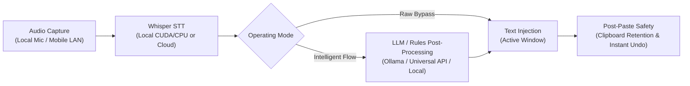

# Velodictum

> **Local-first AI Voice Dictation and In-Place Text Transformation for Windows**  
> A lightweight, open-source desktop assistant for system-wide dictation powered by local or cloud speech-to-text models and optional semantic LLM post-processing (Ollama / Cloud APIs).

[](https://microsoft.com/windows)
[](https://python.org)
[](https://github.com/SYSTRAN/faster-whisper)
[](https://riverbankcomputing.com/software/pyqt/)
[](LICENSE)

**English** | [Deutsch](README.de.md)

> [!NOTE]
> **Project Background & AI Disclaimer:**  
> This project was developed primarily through agentic pair programming with an AI coding agent (Google Gemini). It originally served as a practical exploration project to experiment with autonomous coding agents and modern desktop workflows. Because the resulting application proved genuinely useful and interesting for my daily workflow, it is being shared openly on GitHub.

---

## How It Works

Velodictum records your voice via a global shortcut (or smartphone browser via LAN), transcribes it with Whisper, optionally enhances and cleans up the transcript using an LLM, and automatically injects the formatted text into whatever application is currently focused (e.g. VS Code, browser, Word, Slack, Outlook, Teams).



---

## Core Features

### Two Operating Modes
* **Raw Bypass (`raw`)**: 1:1 verbatim acoustic transcription directly from Whisper without any LLM alteration or latency overhead.
* **Intelligent Flow (`flow`)**: Full AI-powered semantic cleanup. Eliminates filler words (*"um"*, *"uh"*, *"äh"*), resolves spoken self-corrections (*"three, wait no, four"*), formats lists as clean Markdown bullet points, executes spoken punctuation directives, and formats text according to the selected tone.

### Five Tone & Style Profiles (Flow Mode)
1. **Standard**: Balanced, clear, professional tone suitable for daily work.
2. **Formal (Sie-Form)**: Polite business correspondence and formal German phrasing.
3. **Casual (Du-Form)**: Friendly, conversational phrasing using informal addressing.
4. **Concise**: Compact, to-the-point formulations stripped of pleasantries.
5. **Academic**: Elevated register, sophisticated sentence structure, and precise technical vocabulary.

### Flexible Speech-to-Text (STT)
* **100% Offline / Local**: Powered by `faster-whisper` (CTranslate2) running locally with NVIDIA CUDA (FP16) or CPU (Int8) acceleration.
* **Turbo Greedy Search**: Automatic `beam_size=1`, `without_timestamps=True`, and zero CPU-GPU logit stall penalties for `large-v3-turbo` / distilled models (2.5–3.5x faster local STT).
* **Cloud / API**: Ultra-fast Groq Cloud LPU (Whisper-Large-v3, <100ms) or official OpenAI Whisper-1 API.
* **Acoustic Prompt Conditioning**: Injects terms from your personal Custom Vocabulary directly into Whisper's initial decoding prompt.
* **Hallucination Squelcher**: Filters out silence artifacts and low-entropy repetition loops.

### Ultra-Low-Latency Pipeline (Wispr Flow Speed)
* **Parallel Pre-Warming & Prefetching**: Establishes DNS, TCP, and TLS connections to LLM and Cloud STT providers *during* recording via a thread-safe Keep-Alive connection pool (`PersistentHttpPool`), while prefetching deep Win32/UIA window context and workspace terms in the background (0ms post-stop handshake and UIA wait time).
* **Incremental Pause Chunking**: Detects natural speech pauses (≥400ms after ≥1.6s speech) while dictating and transcribes completed speech chunks in the background. In Toggle mode, dictation is often completely transcribed by the time the stop hotkey is pressed (0ms perceived STT latency).
* **Smart Fast-Path (0ms Format Delay)**: Clean, short, already-punctuated Whisper phrases (2–9 words without fillers or spoken markdown) skip cloud LLM roundtrips entirely.
* **LLM Prefix Caching**: Fixed core formatting rules and few-shot examples are pinned at the very top of the system prompt to guarantee 100% prompt prefix cache hits across OpenRouter, Gemini, and OpenAI.

### Decoupled LLM Architecture & Universal API
* **100% Offline**: Local models via Ollama (`qwen2.5:7b`, `llama3.3:70b`, etc.) or zero-latency Local Rules engine.
* **Universal API (OpenAI-Compatible)**: Native connection to any `/chat/completions` endpoint (OpenRouter, DeepSeek, Together AI, Fireworks AI, vLLM, LiteLLM, corporate proxies).
* **Dedicated Cloud Providers**: Official Google Gemini (Gemini 2.5 Flash / Flash-Lite / Pro), OpenAI (GPT-4o, GPT-4.1, o3-mini), Groq (Llama 3.3).
* **Curated 3-Tier Model Speed Catalog**: 1-click presets for **Speed Priority** (<250ms), **Balanced** (300–500ms), and **Highest Quality** (1–2s) with exact-first slug resolution and token pricing telemetry.
* **Zero Data Retention (ZDR)**: Guaranteed data privacy with `data_collection: "deny"` and `zdr: true` enforcement on supported cloud endpoints.

### In-Place Voice Editor ("Velodictum Transform")
* Highlight text in any application, press `Ctrl + Alt + Space`, and speak your instructions (e.g. *"Make this sound more polite"*, *"Translate to English"*, *"Format as bullet points"*, *"Shorten to two sentences"*).
* The highlighted text is replaced in-place.
* Protected against indirect prompt injections via nonce-delimited data isolation.

### Instant Undo & Revert (`Ctrl + Alt + Z`)
* Made a dictation mistake or injected into the wrong window? Press `Ctrl + Alt + Z` to instantly revert the text injection in the active window and restore your previous clipboard content.
* Also supports swapping back to the raw verbatim transcript if AI formatting over-adjusted your phrasing.

### Dictation Scratchpad (`Ctrl + Shift + D`)
* Standalone, focus-aware floating memo window for longer thoughts, brain dumps, and meeting drafts.
* Includes a 1-click **Structure with AI** feature to convert raw thoughts into organized Markdown with headings, bullet points, and task checkboxes (`- [ ]`).

### Mobile LAN Bridge (Smartphone Dictation)
* Zero-config HTTP server running on your local Wi-Fi network.
* Pair your smartphone instantly via QR code in the dashboard.
* Use your phone's microphone as a wireless input device that dictates and pastes directly into your desktop applications without installing any mobile app.

### Context Intelligence & Application Profiles
* Automatically detects the active foreground application (IDE/Code, Email, Chat, Documents, Browser) and adapts formatting conventions.
* Deep caret context inspection via UI Automation analyzes preceding text to handle sentence continuation, matching capitalization, and automatic leading space insertion.

### Smart In-Field Correction & Proper-Noun Learning
* Background monitor watches the active text control after injection.
* When you manually edit a misspelled word (such as a rare name or technical acronym), Velodictum detects the correction and prompts you to add it to your Custom Vocabulary with a single click.

### Dynamic Voice Macros & Smart Snippets
* Spoken shortcuts automatically expand into custom text templates.
* Supports dynamic runtime placeholders (`{date}`, `{time}`, `{weekday}`, `{clipboard}`) with built-in German and English defaults.

### Audio Power Tools
* **Auto-Ducking**: Automatically attenuates background audio (Spotify, YouTube, games) during voice recording via the Windows CoreAudio API.
* **Audio Device Hot-Plug Monitor**: Real-time detection of microphone disconnects and automatic recovery to available fallback devices.
* **Harmonic Procedural Sound Cues**: Zero-dependency acoustic chimes generated in real time with `pyfxr` for 0ms tactile feedback on recording start/stop.
* **Audio File Transcriber**: Transcribe existing audio recordings (WAV, MP3, M4A, etc.) directly from the dashboard.
* **Send-It Voice Action**: Speak *"und absenden"*, *"und abschicken"*, or *"send it"* in messaging apps (Slack, Teams, Discord) to auto-inject text and submit with Enter.
* **Instant Cancel**: Press `Escape` at any time to discard the active recording.

### User Interface & Design System
* **Liquid Glass Design**: Windows 11 Acrylic backdrop (`rgba(14, 14, 18, 0.72)`) with specular highlights and strict Zero-Emoji typography.
* **Physics-Based Floating HUD**: Smooth spring-animated pill overlay with real-time RMS audio visualizer, error-shake feedback, and caret-tracking positioning.
* **Bilingual Localization**: Complete German and English (DE/EN) interface translation across all dashboard tabs, settings, and HUD.

---

## Global Hotkeys

| Shortcut | Default Key | Action | Description |
| :--- | :--- | :--- | :--- |
| **Dictation** | `F8` | Push-to-Talk / Toggle | Captures speech and injects formatted text into the active window |
| **In-Place Voice Editor** | `Ctrl + Alt + Space` | Voice Transform | Transforms highlighted text based on spoken instructions |
| **Instant Undo / Revert** | `Ctrl + Alt + Z` | Revert Injection | Reverts the last text injection in the active window and restores clipboard |
| **Voice Scratchpad** | `Ctrl + Shift + D` | Memo & Notes | Opens the standalone dictation & note-structuring scratchpad |
| **Cancel Recording** | `Escape` | Discard Audio | Immediately cancels and discards the ongoing recording |

> [!TIP]
> All hotkeys, trigger combinations (up to 3 keys), and Push-to-Talk vs. Toggle behaviors can be customized in the **Settings** tab.

---

## Installation & Getting Started

### Prerequisites
* **Windows 10 / 11 (64-bit)**
* **Python 3.10 to 3.13**
* *(Optional)* NVIDIA GPU with CUDA support for accelerated local STT (4–6 GB VRAM recommended; CPU mode works out of the box).

### 1. Clone the Repository
```powershell
git clone https://github.com/4bearyy/Velodictum.git
cd Velodictum
```

### 2. Set Up Virtual Environment & Dependencies
```powershell
python -m venv .venv
.venv\Scripts\Activate.ps1
pip install -r requirements.txt
```

> [!NOTE]
> `requirements.txt` already bundles `nvidia-cublas-cu12` and `nvidia-cudnn-cu12` wheels for CTranslate2 GPU acceleration on Windows.

*(Optional: For GPU PyTorch features):*
```powershell
pip install torch torchvision --index-url https://download.pytorch.org/whl/cu121
```

### 3. Run the Application
You can start Velodictum in two ways:

* **Via Batch Script**: Double-click [`run.bat`](run.bat)
* **Via Command Line**:
  ```powershell
  python main.py
  ```

---

## Building a Standalone Executable (.exe)

To package Velodictum into a portable `.exe` that runs on any Windows machine without requiring Python:

### Option A: Using the Batch Script (Recommended)
Double-click [`build.bat`](build.bat) – it verifies the environment, installs development dependencies from `requirements-dev.txt` if needed, builds the executable, and can optionally create a release-ready ZIP in `dist/`.

### Option B: Using Python Directly
```powershell
pip install -r requirements-dev.txt
python build_executable.py
```
The resulting standalone executable will be in the `dist/Velodictum/` directory.

---

## Project Structure

```text
Velodictum/
├── .ai/                 # System context & architecture decision records (ADRs)
├── core/                # Core engine: STT, LLM providers, audio, injection, config
├── gui/                 # PyQt6 dashboard, floating HUD, theme, widgets, assets
├── tests/               # Automated unit & end-to-end test suites
├── rthooks/             # PyInstaller runtime security hooks
├── build.bat / run.bat  # 1-click Windows starter and build scripts
├── build_executable.py  # PyInstaller standalone executable builder
├── main.py              # Application entry point
├── requirements.txt     # Runtime dependencies
├── requirements-dev.txt # Build & development dependencies (PyInstaller, pytest)
├── README.md            # English documentation
└── README.de.md         # German documentation
```

---

## Privacy & Security

* **Offline-First by Design**: In local STT and local Ollama mode, audio data and transcribed text never leave your machine.
* **Zero Data Retention (ZDR)**: Cloud providers are instructed not to log training or prompt data via explicit headers (`data_collection: "deny"`, `zdr: true`).
* **Secure Key Storage**: API keys are securely encrypted in the Windows Credential Vault using DPAPI hardware-bound encryption and masked in the UI.
* **Sensitive Window & Password Isolation**: Automated injection is blocked in password managers (KeePass, 1Password, Bitwarden) and masked input fields (`ES_PASSWORD`, UIA password properties).
* **UIPI Elevation Guard**: Detects Windows User Interface Privilege Isolation boundaries to prevent input dropping into administrative windows.
* **Prompt Injection Defense**: Voice Editor isolates user clipboard text within delimited nonce tags to prevent untrusted input from hijacking spoken instructions.
* **Zero-Pollution Clipboard**: Uses native Win32 sequence numbers (`GetClipboardSequenceNumber`) instead of sentinel strings, guaranteeing zero clipboard history contamination.

---

## License

This project is licensed under the [MIT License](LICENSE).  
Copyright (c) 2026 Lion Richter.
